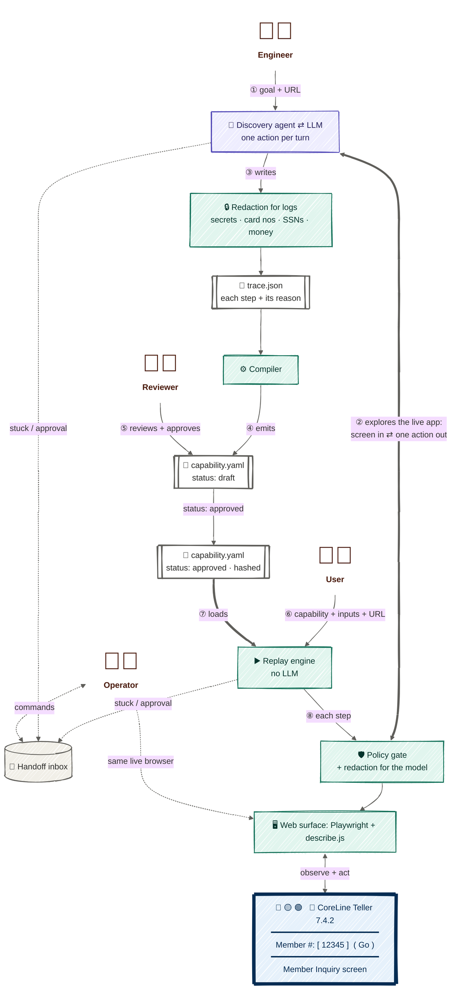

# Design report

> 🗺️ **Every flow as a diagram:** [docs/architecture.md](docs/architecture.md): discovery,
> replay, handoff, and the bank agent.<br/>
> 🧾 **Every claim below has a recorded run:** [evidence/README.md](evidence/README.md), with
> numbered steps 01–23 that this report cites as (NN).<br/>
> ▶️ **How to run it:** [README.md](README.md).

**Stretch goals implemented: two, as the brief suggests.**

| Stretch goal | What I built | Where | Evidence |
|---|---|---|---|
| **#5 Canonicalisation & cross-tenant reuse** | Recorded values become `{{input}}` templates. One base capability, discovered at Acme, runs at other institutions through small per-tenant **overrides** that may only add locators or tighten steps. Overrides are pinned to the base's hash and **generated automatically** from a supervised replay, then approved by a human. The institution is recognised from its first screen, and an unknown one is registered automatically. | §2, §4 | 14–18, 21 |
| **#1 Agent-facing capability interface** | A **catalog** exposes every *approved* capability as a typed tool, with a JSON schema built from its inputs and a description of its outputs and business outcomes. The bank's AI agent (an LLM) picks one by name and fills in the arguments. The call itself is deterministic replay, and the agent gets back only the typed result. It never sees URLs, credentials, the tenant registry or the screen. A request no capability covers is reported through `report_unsupported` instead of being approximated with another tool, and that gap becomes the next discovery goal. | §6 | 19–23 |

## 1. Architecture

The system turns **one** LLM exploration of a legacy screen flow into a **reviewed,
deterministic capability** that runs many times with no model involved. It works in two
phases, joined by a single kind of file. In the **discovery phase**, the LLM explores. In the
**replay phase**, an approved capability is replayed exactly. No LLM is involved in the replay
phase.


<sub>🟪 LLM · 🟩 deterministic code · ⬜ data · 🟦 the legacy bank app's screen. Each flow in detail:
[docs/architecture.md](docs/architecture.md).</sub>

**How it fits together, in order:**
1. An engineer gives only a **goal and a URL** (①).
2. The **discovery agent explores the live app** (②). In each turn it observes the current
   screen through the web surface, and sends the LLM that screen as redacted text (roles,
   captions, table cells, frames) plus a masked screenshot, together with a list of tools.
   The LLM answers with exactly **one action and its reason**. The policy gate checks that
   action before it touches the browser, and the agent records it as a trace step.
3. When the goal is reached, the agent writes **`trace.json`** (③). It goes through a second,
   separate **redaction channel for logs**: secrets appear only by name, and card numbers,
   SSNs, money and the run's known values are masked. The same applies to every event log and
   screenshot. The compiler turns the trace into a
   typed **`capability.yaml`** with `status: draft` (④, section 2). A reviewer reads that file
   and approves it (⑤). Only then does it join the reviewed artifacts. Drafts never run
   unattended.
4. In the replay phase, a user runs a capability, much as the engineer started discovery.
   Instead of a goal, they give the **capability, its typed inputs and the institution's URL**
   (⑥), e.g. `member_savings_balance`, `member_number=24680`. Today that's the CLI; in
   production the bank's AI agent would make the same call.
5. The **replay engine** loads the **approved** `capability.yaml` (⑦), and refuses a draft. It
   runs each step through the same policy gate and surface (⑧), and ends with a typed result
   (section 3). For other institutions running the same app, per-tenant overrides are layered
   on top. That's a stretch goal, covered in section 4.
6. If either phase gets stuck, or reaches an irreversible step, it posts a request to the
   **handoff inbox**. An operator takes over the **same live browser** (section 5).

**Key decisions and their trade-offs:**

| Decision | Why | Trade-off |
|---|---|---|
| The LLM is used only where judgement is needed: exploring a flow in discovery. `cua/replay` never imports `cua/llm.py`. | The production path is cheap, repeatable and auditable; this is a structural guarantee, not a convention. | Replay can't reason its way around something unexpected. It stops or escalates, and reports drift instead. |
| Perception from the page's meaning: roles, captions found in neighbouring cells, table column + row key, frames, occlusion (`describe.js`). The model also gets a masked screenshot. | It is exact and cheap. It also yields locators a reviewer can read ("the field captioned *Member #:*"). | It depends on a DOM. A screen without a DOM needs another `Surface` implementation; the artifact refers to elements by meaning, so it doesn't change (section 4). |
| One action per turn, each with a `reason`. My own loop (about 800 lines with its tools), not an agent framework. | Every action is policy-checked and traced before the next turn. The loop owns stuck detection and handoff, which a framework would hide. | More model turns: the lookup took 8, about $0.15. |
| Capabilities are typed YAML (validated by Pydantic), with draft → approved status and a content hash. | Humans can review them as diffs. Agents can read them as contracts. Approval is pinned to exactly what was reviewed. | YAML can be edited by hand, so the hash and validation have to catch mistakes. |
| One process. The human side is a file inbox plus an operator CLI. | It's the simplest *real* transfer of control over the live session. No queues or services to build. | No authentication and no remote console. The same request/response contract would sit behind a queue and a web UI (section 7). |
| The target is my own Flask "CoreLine Teller", hostile on purpose: iframes, table layout, no ids, `q1` field names, a `<div>` button, errors as HTTP 200, a native confirm dialog. It runs as three tenants, with fault injection. | It reproduces the runtime errors and the multi-tenant variation the brief describes, on demand. | It isn't a real vendor product. Real screens will have quirks the mock doesn't. |

Stack: Python 3.13, Playwright (sync API, Chromium), Pydantic v2, and the Anthropic SDK. The
LLM is `claude-opus-5-5`, with adaptive thinking and prompt caching.

**Which LLMs it works with.** Today the system supports, and has been tested with, **only
Anthropic's Claude models**. Everything that talks to a model goes through a single method,
`respond(system, tools, messages)`, in [cua/llm.py](cua/llm.py). The discovery agent and the
bank agent call only that. The test suite already runs both agents end to end against a
scripted stand-in model, which shows the seam holds. Supporting another provider (OpenAI,
Gemini, a local model) means a small adapter that translates three things: the tool
definitions (the same JSON Schema under different field names), the message format (tool
results and the screenshot image), and the response shape (tool call, text, stop reason,
usage). Nothing else changes. Replay never uses an LLM, and redaction is applied before
anything reaches the model, whichever provider it is. The real constraint is capability, not
code: discovery needs reliable tool calling, one action per turn, and screenshot
understanding. A weaker model would hit stuck detection, and so the human, more often.

The discovery runs in the evidence are real LLM runs against the live mock:
[01](evidence/README.md#01--discovery-of-a-read-flow) (a lookup),
[11](evidence/README.md#11--discovery-of-a-write-flow-with-an-approval) (a write, with an
approval) and 23 (triggered by a capability gap). I took two stretch goals: **#5 cross-tenant
reuse** (section 4) and **#1 the agent-facing catalog**, shown in evidence 19–23.

## 2. Artifact schema

A capability is a **contract**, not a recording. A reviewer and a calling agent read the same
file, and both can see what it needs, what it does, what it returns, and how it can end. This
is the approved lookup, discovered in evidence 01, trimmed:

```yaml
id: member_savings_balance
version: 0.4.0
status: approved                  # draft → approved → deprecated; replay refuses a draft unattended
side_effects: none                # "writes" for open_holiday_share
inputs:
  member_number: {type: string, sensitive: false, example: '12345'}
outputs:
  savings_balance: {type: decimal, sensitive: true}
secrets: [teller_password, teller_user]          # names only; values resolved when the step runs
steps:
- id: fill_member_number
  action: fill
  why: Enter the member number to look up.
  target:
    frame: work
    frame_path: /w/search
    locators:                                    # tried in order; each must match exactly one element
    - {by: caption, role: textbox, caption: 'Member #:'}    # high: what a person reads
    - {by: field_name, tag: input, field_name: q1}          # medium
    - {by: css, css: 'body > form … > input'}               # low
    - {by: position, bbox: [90, 43, 107, 21]}               # low, last resort
  value: '{{member_number}}'
- id: click_select
  action: click
  target:
    locators:
    - {by: role, role: link, name: Select, row_key: '{{member_number}}'}
    - {by: row_control, role: link, row_key: '{{member_number}}'}   # relational: "the link in that row"
  expect: {frames: {work: '/w/member/{{member_number}}'}}            # postcondition
- id: extract_savings_balance
  action: extract
  target: {locators: [{by: table_cell, column: Balance, row_key: '0000'}, …]}
  output: savings_balance
outcomes:                                        # from the app profile, see below
- {code: record_not_found, kind: business, match: {text: No records match criteria.}}
- {code: system_notice, kind: recoverable, recover: {action: click, max_attempts: 3}, …}
- {code: session_expired, kind: failure, match: {text: SEC-440}}
success:
  frames: {main: /main, work: '/w/member/{{member_number}}'}   # required
  outputs: [savings_balance]                                    # required
  texts: [Member Summary]                                       # supporting: a warning if missing
provenance: {discovered_by: claude-opus-5-5, run_id: …, trace_sha256: …, compiler_version: 0.2.0}
content_hash: sha256:b549e39a…
```
<sub>Full file: [evidence/artifacts/member_savings_balance-0.4.0.yaml](evidence/artifacts/member_savings_balance-0.4.0.yaml).
Schema: [cua/artifact/schema.py](cua/artifact/schema.py).</sub>

**Why it's shaped this way:**
- **Each step targets an element with a locator bundle, not a selector.** Legacy screens have
  no ids or test ids, so the first strategies identify an element the way a person does: the
  role and the caption beside it, a table cell by column and row key, "the link in the row for
  this member", "the submit button of the form I just filled". Weaker structural, `css` and
  position fallbacks follow. Each strategy has a fixed confidence (high / medium / low).
  Replay reports which one matched, so a fallback is **visible drift**, not a silent
  guess. An **output** is read only through its primary locator; a fallback may find a
  button, but never supply a value (section 3).
- **Typed inputs and outputs, with no recorded values.** The compiler turns what the LLM typed
  into `{{input}}` templates in values, frame paths and row keys. Choices become enums, e.g.
  `share_type` in `open_holiday_share`, so the agent can't send an option that doesn't exist.
  `sensitive` drives redaction of outputs, and secrets appear only by name.
- **Every action has a postcondition.** `expect` names the screen the step must lead to.
  `success` has a **required** structural part (the expected frames are showing, and every
  output was extracted) and a **supporting** text part.
- **Irreversible steps are marked in the artifact.** `requires_approval: true` (Confirm, in
  `open_holiday_share`) is only valid together with `side_effects: writes`. The policy still checks every step, so
  an artifact can't approve itself past it (section 6).
- **Reviewable and tamper-evident.** It's YAML, with defaults left out, and a `why` on every
  step taken from the LLM's reasons. Pydantic validates it on load: every template refers to a
  declared input, every output is extracted, every secret is used, `form_submit` points to an
  earlier step. `content_hash` covers everything the capability *does*, but not `status`,
  `version` or `provenance`. Approving it doesn't change the hash, while any edit to a step does.
  `provenance` ties it to the exact discovery run and trace.

**Trade-off:** runtime conditions (error pages, notices, timeouts) belong to the **vendor
product**, not to one task. They are written once in an app profile
([apps/coreline_teller.yaml](apps/coreline_teller.yaml)). At compile time, the rules for the
screens the flow visits are copied into the capability. Each artifact is then self-contained and its hash covers its error handling,
at the cost of recompiling capabilities when the profile changes.

## 3. Determinism & error handling

The UI is stable, so the hard part is runtime conditions, not layout drift. Replay is built to
**never guess**, and to **name what it saw**.

**Determinism:**
- **There is no LLM in replay.**
- **Each locator strategy must match exactly one element.** Zero or several matches fall
  through to the next strategy. When none is left, the run stops with `element_not_found` or
  `ambiguous_element` ([locate.py](cua/replay/locate.py)).
- **Waits are condition-based and bounded.** Each step has a 10 s deadline. The surface waits
  for the navigation an action started, by tracking in-flight document requests in every
  frame, never on a fixed sleep.
- **Every navigating step has a postcondition** (`expect`). The final **success checkpoint**
  must hold: the expected frames are showing, and every output has been extracted.

**Error handling.** Outcome rules are checked on **every** observation, so an error page can
never pass as success:

| Class | Replay's response | Evidence |
|---|---|---|
| **Business outcome** | returns it as an answer: `record_not_found`, `invalid_search_input` | 04, 05 |
| **Recoverable** | handles it within a limit, then carries on: dismiss the notice (≤ 3), reload a server error (≤ 2, *never after an irreversible step*); slowness is absorbed by the waits | 06, 07 |
| **Hard failure** | stops: `recovery_exhausted`; `session_expired` (not re-authenticated, since re-running sign-on mid-flow isn't known to be safe); `permission_denied` escalates; `low_confidence_output` (see Drift) | 08, 09, 14 |
| **Needs approval** | an irreversible step never runs unattended | 12 |

Every failure names the error `kind`, the **step**, what was **expected** and what was
**observed**. It comes with a masked screenshot and a structure-only snapshot of the screen.
Exit codes 0 / 3 / 4 / 1 let a caller branch on the outcome.

Unexpected dialogs are dismissed and recorded. An approved irreversible step accepts the
app's own "are you sure?". A browser that dies mid-run gives a structured `session_lost`, and
an app that can't be reached gives `surface_error`, never a crash.

**Drift**, the secondary concern, can never produce a wrong answer. A step whose action still
works through a fallback is listed under `low_confidence_steps`, and a missing success text
adds a warning. An **output**, though, is read only through its primary, reviewed locator. If
that misses and only a fallback matches, replay refuses with `low_confidence_output` and
escalates (14). After a column reorder, a positional fallback would read the wrong amount, and
a confident wrong number is worse than a failure.

## 4. Heterogeneity & multi-tenant

**The surface seam.** All perception and action goes through one `Surface` protocol
([base.py](cua/surface/base.py)). It returns a surface-neutral `Observation` of `Element`s:
role, name, caption, column and row key, frame, bounding box. Artifacts and replay only ever
see those, and locator resolution never touches a browser. The recorded flow says *what* to
act on ("the textbox captioned *Member #:*"); the surface decides *how* to reach it.
- **Legacy web** is what this build runs against.
- **A desktop app** would get a UI Automation surface. Accessibility trees already expose role,
  name, label and bounding box, so the same locator kinds carry over, with windows in place of
  frames.
- **Screens with no tree** (terminal emulators, remote desktops) would get an OCR / vision
  surface emitting the same `Element`s, with locators leaning on caption and position.

Schema, replay, policy and handoff stay unchanged. Only the web surface is built.

**Multi-tenant reuse (stretch goal #5).** Many institutions run the same vendor product,
configured differently, so I don't re-record per tenant:
- **One base capability per task and product.** It's as label-independent as possible:
  relational locators find "the submit of this form" and "the link in this row" even when
  labels change.
- **A per-tenant override** holds only what differs: a few captions, a column, a title. It may
  **add** locators (base ones stay as fallback) and outcome rules, replace success texts, and
  make a step **stricter**. It can never change the steps, actions, values, inputs or outputs. It is
  **pinned to the base's `content_hash`**, and both files must be approved
  ([overrides.py](cua/artifact/overrides.py)).
- **The institution is identified from its first screen**, not its URL. A signature (name
  weighted 5, title 2, each screen text 1; ≥ 0.75 to match, with a 0.10 margin over the
  runner-up) is matched against a registry that holds no URLs. An unknown bank is registered
  automatically, for review (18).

**Drift management, as it ran:**
1. Unattended, the base **refused** to answer at Riverbend: its balance column was reachable
   only by a fallback (14).
2. A supervised probe ran it through, and **generated a draft override** with exactly the
   differences (16).
3. A human approved it, and every step was then high-confidence (17).
4. After the base was recompiled, the old override was **refused** (`override_invalid`), not
   silently reused (15).

One discovery serves three institutions. I built the abstractions, not the infrastructure.

## 5. Escalation & handoff

**Detecting "stuck".**
- **In discovery:** 3 actions in a row that change nothing, 3 failed actions, 3 turns without a
  tool call, the 30-action or 10-minute limit, or the LLM calling `request_human`.
- **In replay:** an unrecoverable condition, or a recovery limit running out.
- **In both:** any irreversible step.

**Routing.** The run posts an **intervention request** to an inbox. It says:
- why it stopped (`stuck` / `unrecoverable` / `approval_needed`);
- the capability or goal, the step and the reason;
- the screen's frames and headings, a masked screenshot, and the recent steps;
- exactly which operator actions are allowed.

The operator CLI ([operator.py](cua/operator.py)) is a separate process that talks to the
automation only through that inbox.

**Who is in control.** A state machine, `automation → awaiting_human → human → automation |
finished`, is **enforced inside the surface**: while a human holds control, any automation
action fails with `not_in_control`. One rule, `allowed_now()`, decides which commands are
possible, for both sides. The CLI refuses an impossible command rather than pretend it was
sent.

**The same live session.** Nothing is reopened; the automation keeps the browser alive while
it waits. After `take`, a recorder injected into the page captures the operator's actions with
the **same element fingerprints the agent uses**. They are stored as `actor: human` steps, and
discovery compiles them like any other step. On `resume`, replay **resynchronises** to the
first remaining step whose screen is showing. It goes back only if nothing irreversible has
run (10). On `approve`, the automation performs the gated step itself, and records who approved
it (11, 13).

`reject`, `abort` or a timeout ends the run, naming who and why. A closed window gives
`session_lost`.

**Trade-off:** a CLI plus a file inbox instead of a console, which the brief puts out of
scope. The control model and the request/response contract are real. In production, the same
contract would sit behind a queue and a web UI.

## 6. Safety

**The guardrails are enforced in code, outside the LLM** ([policy.yaml](policy.yaml)), on
every action in both phases:
- **Allowlist.** Every browser request, frames and assets included, must go to an allowed
  origin. The mock's `/__control` fault switches are blocked. Only nine action types are
  allowed, and three keys.
- **Irreversible actions.** A control whose label matches the irreversible list (Confirm, Post,
  Submit, Approve, Transfer, Delete…, Close account, Pay) gives `needs_approval`, in discovery
  and in replay alike. An approved artifact can't skip this check (11, 12). I chose **approval
  over blocking** because real back-office work includes writes: a person decides, and the run
  records who.
- **Secrets by name.** The LLM calls `type_secret(teller_password)`. The value comes from the
  environment, and is never shown to the model or written anywhere.
- **Two redaction channels:**
  - **Model:** SSNs, card numbers (Luhn-validated, so ids aren't masked), emails and dates of
    birth. Balances stay visible, so the model can reason about them.
  - **Logs:** all of the above, plus money.
  - **Both:** secrets and any `sensitive` input or output are masked as known values.
    Persisted screenshots are masked when taken. A scan of all the evidence for secrets and
    seed PII finds nothing.
- **The agent boundary (stretch goal #1).** The bank's AI agent sees only approved
  capabilities, as typed tools. It never sees URLs, the registry, credentials or screens (22).

**Limits.**
- Irreversibility is judged from **labels**, so a destructive button labelled "OK" would slip
  through. `requires_approval` on a step narrows the gap, but doesn't close it.
- Redaction is **pattern-based**. A name in free text is caught only as a known value, or by
  screenshot masking, which relies on the DOM.
- The inbox has **no authentication**: the operator is the OS user.
- The policy governs the automation, not the bank app. The app's own permissions remain the
  real authority.

## 7. Cuts

**Deliberately left out:**
- **Desktop and vision surfaces:** designed in section 4, not built.
- **An operator console, and authentication for the inbox.**
- **An LLM fallback during replay.** Replay stays deterministic, and failures go to a human.
- **Automatic re-authentication.** It isn't known to be safe in the middle of a flow.
- **Stability scoring and code generation:** stretch options I didn't take.
- **Vault-backed, per-tenant secrets.** One `.env` serves the mock.
- **Product-version checks.** A capability declares `versions: '>=7.4'`, but replay doesn't yet
  check the version shown on screen.
- **Other LLM providers.** Only Claude is supported and tested. Other providers need a small
  adapter behind `respond()` (section 1).
- **Queues and services.**

**What I'd build next:**
1. Stability scoring: N replays under fault injection, gating approval.
2. A web operator console on the same inbox contract, with authenticated operators.
3. A UI Automation desktop surface, to prove the seam.
4. Version checks, and per-tenant secrets from a vault.
5. A diff view for reviewing a drafted override or a recompiled capability.
