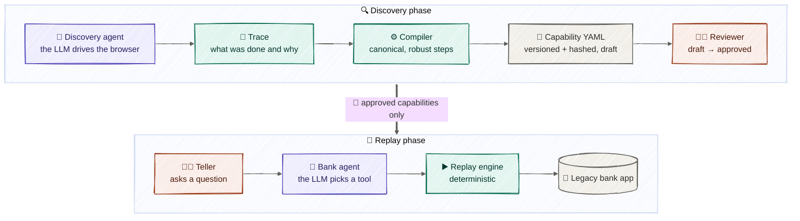
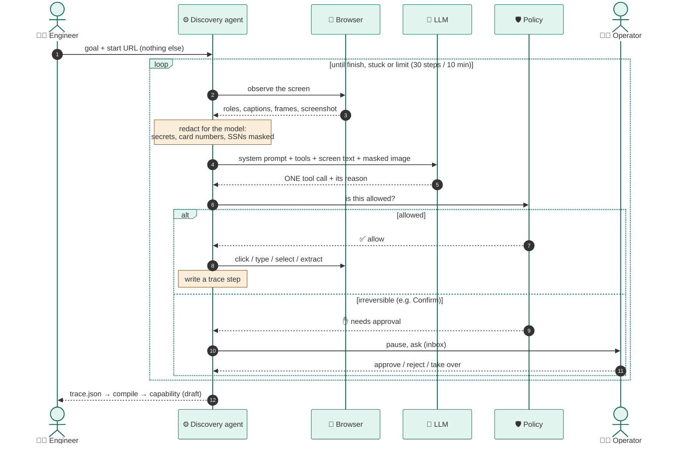
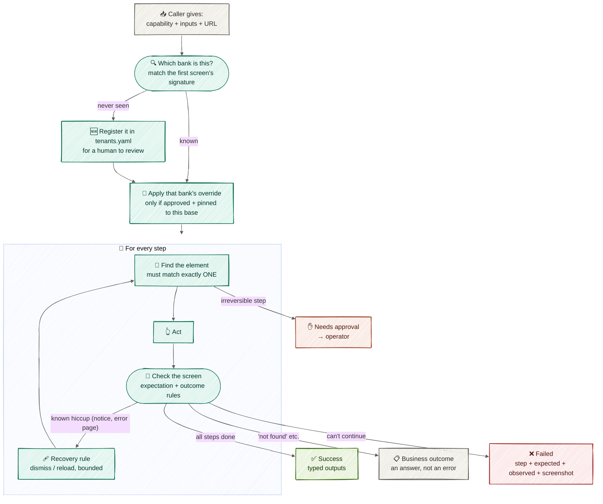
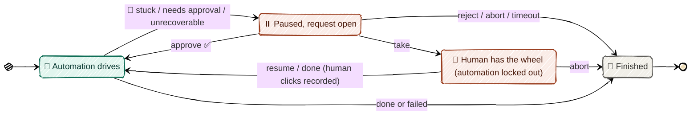
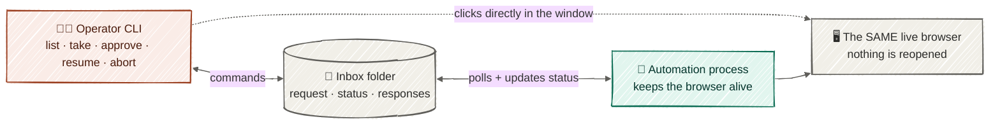
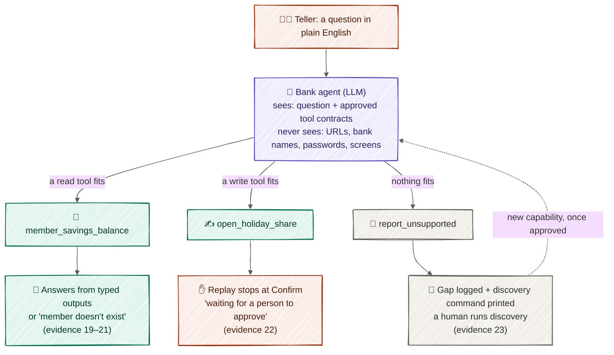

# Architecture, in pictures

Colours mean the same thing in every picture:
🟪 **an LLM call** · 🟩 **deterministic code** · 🟧 **a human** · ⬜ **data, stores, the bank app**

---

## 1. The big picture: learn once, then repeat without an LLM

**The idea:** in the **discovery phase**, the LLM explores once per task, to *learn* how the
task is done in the bank's UI. The result is a plain file that a human approves. In the
**replay phase**, on every request, the task runs from that file, the same way every time,
with no model in the execution. Both phases share the policy allowlist, redaction, the tenant registry and
overrides, the handoff inbox, and the evidence logs.

---

## 2. Discovery: one look, one action, every turn

**The LLM's input** is the screen as redacted text plus a masked screenshot. **Its output** is
exactly one action with a reason. Passwords go in through `type_secret`, by name only, so
the LLM never sees them.

---

## 3. Replay: no guessing allowed

**Rule of thumb:** if the replay isn't sure, it stops and says why. It never clicks the
"closest" thing.

---

## 4. Handoff: passing the steering wheel

### Who is in control

### How the two sides talk

The automation and the operator are separate programs. The inbox is their mailbox, and the
browser window is shared. If the window gets closed, the run ends cleanly as `session_lost`.

---

## 5. The bank's AI agent: three things can happen

**The LLM decides *what* to do.** The catalog and replay decide *how*: deterministically, with
the bank's own rules and a human in charge of anything irreversible.
